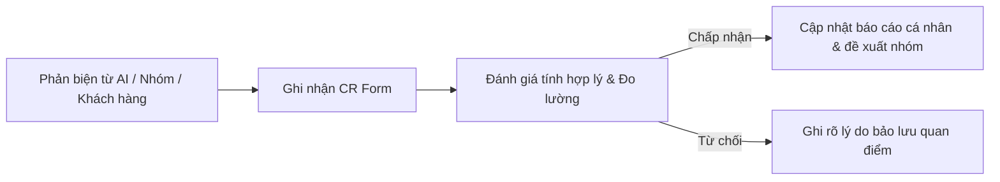

# Change Request (CR) & Decision Log — Nguyễn Tiến Cường (MSSV: 2A202603425)

> Nhật ký cá nhân theo dõi các **Yêu cầu Thay đổi (Change Request - CR)** và **Quyết định (Decision Log)** trong suốt quá trình Discovery & Problem Framing (từ CP2 đến CP7).
> Dùng để lưu vết quá trình tư duy, phản biện và tiến hóa của bài toán, phục vụ cho phần Reflection cá nhân (CP7) và đối soát điểm liêm chính.

---

## 📌 Quy trình ghi nhận CR cá nhân



---

## 📋 Bảng tổng hợp Change Requests cá nhân

| CR-ID | Checkpoint | Ngày/Giờ | Nguồn phản biện | Hạng mục thay đổi | Quyết định | Tác động chính |
|:---:|:---:|:---:|---|---|:---:|---|
| **CR-01** | CP2 | 09/11 11:05 | AI (PM hoài nghi) | Metric thời gian setup & Boundary lệnh shell | **Accepted** | Cập nhật Problem Card #1 (Mục 3 báo cáo cá nhân) |
| **CR-02** | CP3 | 09/11 12:30 | Phản biện nhóm khi pitch | Bối cảnh xảy ra lỗi & Loại trừ Card #2 | **Accepted** | Cập nhật Mục 4 báo cáo cá nhân & group_report CP3 |
| **CR-03** | CP4 | 09/11 14:15 | Kết quả phỏng vấn/research | Bóc tách khoảng trống Docker & Insight người dùng | **Accepted** | Định vị AI Workflow xử lý log lỗi thay vì thay thế Docker |
| **CR-04** | CP5–6 | 09/11 15:00 | Đánh giá an toàn & mức AI | Giới hạn mức Workflow & cấm đọc source code | **Accepted** | Hoàn thiện Problem Statement v1 & Boundary an toàn |

---

## 🔍 Chi tiết từng Change Request

### CR-01: Tách bạch Metric thời gian thao tác & Giới hạn quyền chạy lệnh shell của AI
- **Mã CR:** `CR-01`
- **Checkpoint phát sinh:** `CP2 — Problem Cards & Quy trình nháp`
- **Người đề xuất:** Nguyễn Tiến Cường (sau phản biện từ AI)
- **Nguồn phản biện:** AI đóng vai PM hoài nghi chỉ ra 2 lỗ hổng lớn:
  1. Target metric *"giảm từ 360 phút xuống 45 phút"* là phi thực tế nếu máy tính yếu hoặc mạng tải package nặng hàng gigabyte.
  2. Để AI tự sinh và chạy lệnh cài đặt tiềm ẩn rủi ro bảo mật hệ thống nghiêm trọng.
- **Nội dung thay đổi:**
  - *Trước thay đổi (Before):* Giảm tổng thời gian từ 360 phút xuống 45 phút; AI tự động sinh và chạy script cài đặt.
  - *Sau thay đổi (After):* 
    - Sửa metric thành: Thời gian **thao tác và gỡ lỗi của kỹ sư** giảm từ 270 phút xuống dưới 30 phút (không tính thời gian tải mạng thụ động).
    - Thêm boundary: AI chỉ phân tích log lỗi crash và gợi ý giải pháp; con người (Dev) trực tiếp duyệt và bấm chạy lệnh.
- **Tác động đến tài liệu:** Đã cập nhật vào Problem Card #1 và Bảng phản biện AI (Mục 3 trong `report/individual/2A202603425_NguyenTienCuong.md`).
- **Trạng thái:** **Accepted**.

---

### CR-02: Bổ sung bối cảnh Docker lỗi thời & Loại trừ bài toán Lệch môi trường Dev-Test
- **Mã CR:** `CR-02`
- **Checkpoint phát sinh:** `CP3 — Hội tụ nhóm`
- **Người đề xuất:** Nguyễn Tiến Cường (sau phản biện từ Khanh và Khôi)
- **Nguồn phản biện:** 
  1. Khanh hỏi: *"Nếu dự án đã có Dockerfile từ trước thì bài toán setup này còn tồn tại không?"*
  2. Khôi hỏi: *"Tester test trên Staging CI/CD thì sao lại lệch môi trường local? Nếu do DB data/migration thì AI có vi phạm bảo mật không?"*
- **Nội dung thay đổi:**
  - *Trước thay đổi:* Coi bài toán setup chỉ xảy ra khi dự án chưa có Docker; coi Card #2 (Lệch môi trường Dev-Test) là ứng viên tiềm năng thứ hai.
  - *Sau thay đổi:* 
    - Làm rõ: Nỗi đau setup xảy ra cả ở dự án có Docker nhưng base image/dependency cũ bị crash do upstream thay đổi.
    - Nhận thấy Card #2 phụ thuộc nhiều vào quy trình CI/CD Staging chuẩn (No-AI), ranh giới AI yếu nên chủ động rút Card #2 để dồn toàn lực bảo vệ Card #1.
- **Tác động đến tài liệu:** Cập nhật Mục 4 báo cáo cá nhân và bảng chấm điểm Shortlist trong `group_report.md`.
- **Trạng thái:** **Accepted**.

---

### CR-03: Định vị AI vào khoảng trống của Docker qua kiểm chứng thực tế
- **Mã CR:** `CR-03`
- **Checkpoint phát sinh:** `CP4 — Kiểm chứng & Research`
- **Người đề xuất:** Nguyễn Tiến Cường (cùng nhóm sau The Mom Test & Research)
- **Nguồn phản biện:** 
  - Phỏng vấn Dev outsource cho thấy: Người dùng không ngại cài đặt công cụ mà bất lực vì đọc log crash hàng nghìn dòng.
  - Research Dev Containers & Docker Compose cho thấy: Docker không giải thích được lý do khi build image fail.
- **Nội dung thay đổi:**
  - *Trước thay đổi:* Dự định cho AI tham gia từ đầu quá trình viết script setup.
  - *Sau thay đổi:* Để Docker và script đảm nhận toàn bộ khâu hạ tầng (No-AI); chỉ kích hoạt AI ở đúng bước phân tích log lỗi khi build fail để đưa ra giải thích và lệnh vá.
- **Tác động đến tài liệu:** Cập nhật Quy trình tương lai (Mục 4.2 trong `group_report.md`).
- **Trạng thái:** **Accepted**.

---

### CR-04: Giới hạn mức can thiệp ở Workflow và thiết lập Boundary bảo mật mã nguồn
- **Mã CR:** `CR-04`
- **Checkpoint phát sinh:** `CP6 — Mức can thiệp AI & Quyết định`
- **Người đề xuất:** Nguyễn Tiến Cường (cùng Vũ)
- **Nguồn phản biện:** Phân tích 4 rủi ro sản phẩm (Cagan) và bảo mật mã nguồn khách hàng.
- **Nội dung thay đổi:**
  - *Trước thay đổi:* Xem xét giải pháp Agent tự động chạy lệnh trong terminal.
  - *Sau thay đổi:* 
    - Kiên quyết chọn mức **Workflow**, từ chối Agent vì rủi ro phá hoại hệ thống (`sudo rm -rf`).
    - Bổ sung Boundary khắt khe: AI tuyệt đối không đọc source code nghiệp vụ bảo mật (chỉ đọc log terminal và manifest), con người là chốt chặn cuối cùng kiểm duyệt lệnh trước khi chạy.
- **Tác động đến tài liệu:** Cập nhật Mục 6.1, 6.2, 8.2 trong `group_report.md` và Mục 5, 6 trong `2A202603425_NguyenTienCuong.md`.
- **Trạng thái:** **Accepted**.

```markdown
### CR-0X: [Tên thay đổi ngắn gọn]
- **Mã CR:** `CR-0X`
- **Checkpoint phát sinh:** `CP...`
- **Nguồn phản biện:** (Câu hỏi từ bạn nào trong nhóm / từ người được phỏng vấn / từ bài research)
- **Nội dung thay đổi:**
  - *Trước thay đổi (Before):* ...
  - *Sau thay đổi (After):* ...
- **Tác động đến tài liệu:** (Sửa ở mục nào trong file cá nhân hoặc đề xuất sửa trong group_report.md)
- **Trạng thái:** Accepted / Rejected / Modified
```
