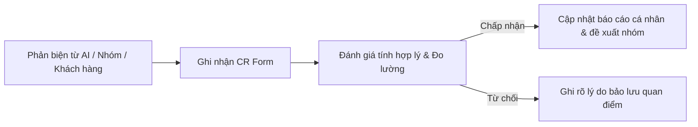

# Change Request (CR) & Decision Log — Nguyễn Tiến Cường (MSSV: 2A202603425)

> Nhật ký cá nhân theo dõi các **Yêu cầu Thay đổi (Change Request - CR)** và **Quyết định (Decision Log)** trong suốt quá trình Discovery & Problem Framing (từ CP2 đến CP7).
> Dùng để lưu vết quá trình tư duy, phản biện và tiến hóa của bài toán, phục vụ cho phần Reflection cá nhân (CP7) và đối soát điểm liêm chính.

---

## 📌 Quy trình ghi nhận CR cá nhân



---

## 📋 Bảng tổng hợp Change Requests cá nhân

| CR-ID | Checkpoint | Ngày/Giờ | Nguồn phản biện | Hạng mục thay đổi | Quyết định | Tác động chính |
|:---:|:---:|:---:|---|---|:---:|---|
| **CR-01** | CP2 | 09/11 11:05 | AI (PM hoài nghi) | Metric thời gian setup & Boundary lệnh shell | **Accepted** | Cập nhật Problem Card #1 (Mục 3 báo cáo cá nhân) |
| **CR-02** | CP3 | 09/11 ... | Phản biện nhóm khi pitch | *(Ghi nhận sau khi nhóm phản biện Card #1)* | *Pending* | Cập nhật Mục 4 báo cáo cá nhân |
| **CR-03** | CP4 | 09/11 ... | Kết quả phỏng vấn/research | *(Ghi nhận sau khi kiểm chứng)* | *Pending* | Cập nhật giả định & insight |
| **CR-04** | CP5–6 | 09/11 ... | Phản biện quy trình & mức AI | *(Ghi nhận khi xác định Boundary/Mức AI)* | *Pending* | Cập nhật Problem Statement v0 -> v1 |

---

## 🔍 Chi tiết từng Change Request

### CR-01: Tách bạch Metric thời gian thao tác & Giới hạn quyền chạy lệnh shell của AI
- **Mã CR:** `CR-01`
- **Checkpoint phát sinh:** `CP2 — Problem Cards & Quy trình nháp`
- **Người đề xuất:** Nguyễn Tiến Cường (sau phản biện từ AI)
- **Nguồn phản biện:** AI đóng vai PM hoài nghi chỉ ra 2 lỗ hổng lớn:
  1. Target metric *"giảm từ 360 phút xuống 45 phút"* là phi thực tế nếu máy tính yếu hoặc mạng tải package nặng hàng gigabyte.
  2. Để AI tự sinh và chạy lệnh cài đặt tiềm ẩn rủi ro bảo mật hệ thống nghiêm trọng.
- **Nội dung thay đổi:**
  - *Trước thay đổi (Before):* Giảm tổng thời gian từ 360 phút xuống 45 phút; AI tự động sinh và chạy script cài đặt.
  - *Sau thay đổi (After):* 
    - Sửa metric thành: Thời gian **thao tác và gỡ lỗi của kỹ sư** giảm từ 270 phút xuống dưới 30 phút (không tính thời gian tải mạng thụ động).
    - Thêm boundary: AI chỉ phân tích log lỗi crash và gợi ý giải pháp; con người (Dev) trực tiếp duyệt và bấm chạy lệnh.
- **Tác động đến tài liệu:** Đã cập nhật vào Problem Card #1 và Bảng phản biện AI (Mục 3 trong `report/individual/2A202603425_NguyenTienCuong.md`).
- **Trạng thái:** **Accepted**.

---

### Mẫu form ghi nhận CR tiếp theo (Dùng khi pitch nhóm hoặc kiểm chứng)

```markdown
### CR-0X: [Tên thay đổi ngắn gọn]
- **Mã CR:** `CR-0X`
- **Checkpoint phát sinh:** `CP...`
- **Nguồn phản biện:** (Câu hỏi từ bạn nào trong nhóm / từ người được phỏng vấn / từ bài research)
- **Nội dung thay đổi:**
  - *Trước thay đổi (Before):* ...
  - *Sau thay đổi (After):* ...
- **Tác động đến tài liệu:** (Sửa ở mục nào trong file cá nhân hoặc đề xuất sửa trong group_report.md)
- **Trạng thái:** Accepted / Rejected / Modified
```
