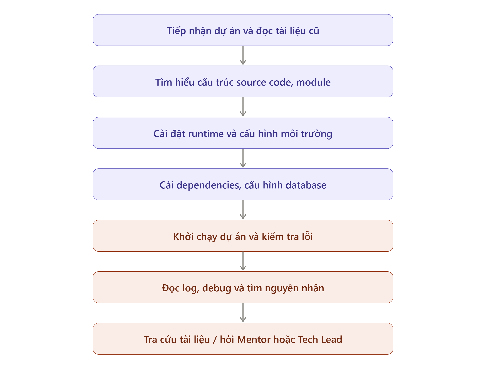

# Báo cáo nhóm — Day 02 Discovery & Problem Framing

> Bản chung của nhóm, viết trên repo do nhóm trưởng fork. Không copy file này sang repo cá nhân.
> Template chi tiết và prompt mẫu: [docs/01-worksheet.md](../../docs/01-worksheet.md). Bài mẫu: [docs/02-deliverable-example.md](../../docs/02-deliverable-example.md).

## 1. Thông tin nhóm

- Tên nhóm: CodeX
- Thành viên: xem `TEAM.md`
- Candidate problem được chọn (1 câu): Khi tiếp nhận một dự án outsource/maintain cũ (hoặc onboard thành viên mới) mà tài liệu cài đặt đã lỗi thời, Developer và Techlead lãng phí 4–8 tiếng để gỡ lỗi crash do xung đột thư viện/version; nhóm hướng tới giải pháp chuẩn hóa môi trường bằng Docker (No-AI) kết hợp AI Workflow phân tích log lỗi build để giảm thời gian setup xuống dưới 30 phút.
- Quyết định cuối: *(Chưa quyết định — hoàn thiện ở CP6)*

---

## 2. Hội tụ nhóm (CP3)

### 2.1. Pitch

| # | Người đưa ra | Candidate (Job Story ngắn) | Actor | Bottleneck | Câu hỏi phản biện nhận được (ai hỏi) |
|---:|---|---|---|---|---|
| 1 | Nguyễn Tiến Cường | Khi tiếp nhận dự án outsource/maintain cũ mà docs outdate, tôi muốn có hướng dẫn cài đặt chuẩn, để đưa code lên chạy mà không tốn công người khác | Dev mới, Tester, Techlead | Crash do xung đột version thư viện/runtime; phải gọi Techlead debug (270') | Nếu dự án đã có sẵn Dockerfile thì bài toán này còn tồn tại không? (Thành viên 2 hỏi) |
| 2 | Nguyễn Tiến Cường | Khi Tester phát hiện lỗi mà máy Dev chạy bình thường, tôi muốn xác định nhanh khác biệt giữa 2 máy, để sửa bug không mất thời gian tranh cãi | Dev, Tester | So sánh thủ công cấu hình, version package và data test giữa 2 máy (60') | Tại sao Tester không test trên Staging có CI/CD mà test máy local? Nếu lệch do DB data/migration thì AI có vi phạm bảo mật không? (Nguyễn Quang Vũ hỏi) |
| 3 | Nguyễn Tiến Cường | Khi API trên Swagger bị thiếu hoặc không chạy đúng spec, tôi muốn biết ngay người làm API, để xác nhận sửa mà không phải hỏi vòng qua nhiều cấp | Frontend Dev, Backend Dev, BA | Hỏi lòng vòng qua BA, Techlead, PM để tìm ra tác giả API (35') | Vấn đề này chỉ cần siết lại quy định ghi author/metadata vào Swagger là xong, tại sao cần làm phức tạp bằng AI? (Thành viên 4 hỏi) |
| 4 | Thành viên 2 | Khi vừa code xong bài tập lớn, muốn công cụ tự quét code sinh file README.md và tóm tắt hàm chính, để nộp bài đúng hạn không phải gõ lại | Sinh viên, Dev | Đọc lại code để nhớ luồng và tự gõ, căn chỉnh Markdown từ trang trắng (45–60') | Cả kỳ chỉ nộp 1-2 BTL thì tần suất có quá thấp? Thầy cô chấm điểm file Báo cáo Word/PDF và cần hướng dẫn cài đặt môi trường chứ AI đọc code sao biết nghiệp vụ thật? (Cường hỏi) |
| 5 | Thành viên 2 | Khi bạn cùng nhóm push code mới, muốn nhận tóm tắt "Ai vừa sửa gì, ảnh hưởng file nào của tôi", để lúc ghép bài không bị lỗi bất ngờ | Các thành viên làm cùng project | Tự dò hàng trăm dòng git diff không chú thích và chờ bạn trả lời tin nhắn giải thích (30–60') | Sập code trước giờ demo là do thiếu quy trình/test hay do không đọc git diff? AI tóm tắt văn bản có ngăn được runtime bug không hay chỉ cần No-AI họp sync 5 phút? (Cường hỏi) |
| 6 | Thành viên 2 | Khi đi xin thực tập/việc làm, muốn AI đọc trực tiếp đồ án trong máy để viết 3–4 gạch đầu dòng kinh nghiệm khớp với JD, để sửa CV nhanh | Người chuẩn bị CV xin việc | Lục lại code/báo cáo cũ tìm thư viện, số liệu thật và viết sang văn phong tuyển dụng khớp JD (30–45'/dự án) | Code đồ án sinh viên làm gì có số liệu impact kinh doanh thật? Đưa vào ChatGPT prompt 1 phút là xong, có cần tạo tool đọc cả folder code không? (Cường hỏi) |
| 7 | Nguyễn Quang Vũ | Khi xe gặp sự cố giữa đường, muốn tìm gara/tiệm sửa xe lưu động gần nhất có thể hỗ trợ, để khắc phục nhanh không phải dắt xe đi xa | Người đi làm, tài xế công nghệ | Tìm kiếm và gọi điện liên hệ nhiều nơi để xác định thợ có sẵn sàng đến hỗ trợ lưu động không (15–30') | Đây là bài toán bản đồ/directory (No-AI), các tiệm sửa xe ven đường đa phần không dùng app, làm sao cập nhật trạng thái thợ thời gian thực? (Cường hỏi) |
| 8 | Nguyễn Quang Vũ | Khi dùng máy tính/điện thoại lâu ngày, muốn hệ thống định kỳ kiểm tra, dọn rác, phát hiện mã độc và tối ưu tài nguyên để máy chạy ổn định | Nhân viên văn phòng, người dùng máy tính | Tự tra cứu Internet, mò mẫm Task Manager/ổ đĩa mà không biết chính xác nguyên nhân gây chậm (20–60') | Hệ điều hành đã có sẵn Task Manager, Storage Sense, Antivirus tự động. Can thiệp sâu vào tài nguyên hệ thống có nguy cơ crash OS và vi phạm bảo mật không? (Thành viên 2 hỏi) |
| 9 | Nguyễn Quang Vũ | Khi xảy ra tai nạn giao thông xe chắn đường, muốn hệ thống hỗ trợ ghi nhận bằng chứng hiện trường, hồ sơ ban đầu và điều phối cứu hộ để giải phóng đường | CSGT, lực lượng cứu hộ, người tham gia giao thông | Ghi nhận bằng chứng, hoàn thiện hồ sơ và điều phối cứu hộ diễn ra tuần tự, rời rạc giữa các bên (30–60') | Bài toán phụ thuộc hoàn toàn vào thẩm quyền pháp lý của CSGT và bảo hiểm; làm sao nhóm sinh viên kiểm chứng và triển khai thực tế được trong lab? (Thành viên 4 hỏi) |
| 10 | Thành viên 4 | Khi làm việc nhóm, trưởng nhóm muốn theo dõi tiến độ công việc tập trung thay vì rải rác trên Zalo/Messenger/Drive để phát hiện trễ hạn kịp thời | Trưởng nhóm và thành viên | Phải hỏi từng người, chờ phản hồi và tự tổng hợp tiến độ thủ công (20–40') | Zalo/Messenger là app chat đóng, chặn API bên ngoài thì AI đọc tin nhắn thế nào? Thành viên không báo cáo là do thiếu kỷ luật chứ công cụ sao ép được? (Cường hỏi) |
| 11 | Thành viên 4 | Khi học nhiều môn trong kỳ, sinh viên muốn quản lý tập trung deadline từ LMS, email và chat nhóm để không bị quên hoặc nộp muộn bài tập | Sinh viên học nhiều môn | Phải kiểm tra nhiều nguồn rời rạc, tự nhớ và đối chiếu hạn nộp (15–30'/tuần) | Hệ thống LMS trường đóng kín không có open API; đầu kỳ nhập 10 phút vào Google Calendar (No-AI) là có chuông báo tự động, tại sao cần AI phức tạp? (Cường hỏi) |
| 12 | Thành viên 4 | Khi ôn tập hoặc làm bài, sinh viên muốn tìm kiếm nhanh tài liệu (slide, bài tập, giáo trình) nằm phân tán trên LMS, Drive, chat nhóm | Sinh viên | Phải lục tìm trên từng nền tảng, nhớ tên file hoặc phải chờ bạn bè gửi lại (15–20'/lần) | Nếu nhóm tạo 1 folder Google Drive chung (No-AI) từ đầu kỳ thì vấn đề có còn không? Đây là bài toán Search/Index truyền thống chứ AI can thiệp vào bước nào? (Thành viên 2 hỏi) |

### 2.2. Cluster

| Cluster | Các candidate | Pattern chung |
|---|---|---|
| A — Môi trường & Triển khai phát triển phần mềm | #1, #2, #5 | Giải quyết các bất đồng, lỗi xung đột môi trường và mã nguồn giữa các máy/thành viên trong quy trình dev/test |
| B — Hỗ trợ tài liệu & Báo cáo học tập / nghề nghiệp | #3, #4, #6 | Trích xuất thông tin từ code/spec để sinh tài liệu (README, CV, API mapping) cho người khác đọc |
| C — Tiện ích đời sống, Thiết bị & Xã hội | #7, #8, #9 | Tìm kiếm, cứu hộ, tối ưu thiết bị và xử lý hiện trường sự cố vật lý ngoài đời thực |
| D — Quản lý học tập & Giao tiếp nhóm sinh viên | #10, #11, #12 | Theo dõi deadline, tiến độ và gom tài liệu học tập bị phân tán trên nhiều ứng dụng chat/LMS |

### 2.3. Opportunity Solution Tree rút gọn

Gốc là **1 outcome**. Nhánh là **opportunity** (nhu cầu, pain), không phải tính năng hay công cụ.

```text
OUTCOME: Giảm 70% thời gian chết (downtime) và tắc nghẽn của kỹ sư/thành viên khi tiếp nhận và chuyển giao mã nguồn dự án
├── Opportunity A (Môi trường & Setup): Giảm thời gian cài đặt và gỡ lỗi xung đột dependency khi tiếp nhận dự án cũ hoặc onboard người mới
├── Opportunity B (Phối hợp Dev-Test): Rút ngắn thời gian xác định nguyên nhân sai lệch môi trường khi xảy ra lỗi "it works on my machine"
└── Opportunity C (Chuyển giao mã nguồn): Tự động nắm bắt các thay đổi cốt lõi trong code và tài liệu khi có thành viên mới hoặc push code mới
```

Những ý đã gạch bỏ vì là solution đội lốt opportunity:

- "Chatbot AI tự động fix bug khi có exception" (Gợi ý viển vông, solution-first không khả thi)
- "Bot tự đọc tin nhắn Zalo/Messenger để nhắc việc" (Vi phạm chính sách API và rào cản nền tảng đóng)
- "App cứu hộ xe và xử lý hiện trường tai nạn" (Solution đội lốt, vượt quá phạm vi và quyền hạn kỹ thuật của lab CNTT)

### 2.4. Chấm điểm shortlist (1–5)

| Candidate | Actor rõ | Quy trình rõ | Pain có bằng chứng | Impact đo được | Vừa sức lab | So sánh được No AI/Rule/Workflow/Agent | Nhóm hiểu domain | Tổng |
|---|---:|---:|---:|---:|---:|---:|---:|---:|
| #1: Setup môi trường dự án cũ / onboard (Cường) | 5 | 5 | 5 | 5 | 4 | 5 | 5 | 34 |
| #5: Tóm tắt thay đổi code nhóm - git diff (Thành viên 2) | 4 | 4 | 4 | 4 | 4 | 3 | 4 | 27 |
| #10: Theo dõi tiến độ làm việc nhóm Zalo/Drive (Thành viên 4) | 4 | 3 | 3 | 3 | 2 | 3 | 4 | 22 |

**Candidate được chọn:**  
Candidate #1 — Setup môi trường dự án outsource/maintain cũ hoặc onboard thành viên mới (do Nguyễn Tiến Cường đề xuất).

**Vì sao chọn:**  
- Đạt điểm cao nhất trong bảng chấm điểm (34/35 điểm).
- Nỗi đau lớn nhất và đo lường được bằng số liệu thực tế (lãng phí 4–8 tiếng, bottleneck 270 phút của nhân sự mới và 1–2 tiếng của Techlead/Senior).
- Ranh giới giải pháp cực kỳ rành mạch: Nền tảng chuẩn hóa môi trường bằng **Docker (No-AI)**, AI chỉ can thiệp theo dạng **Workflow** để đọc và phân tích log lỗi xung đột thư viện/runtime khi build fail.
- Hoàn toàn nằm trong tầm kiểm soát kỹ thuật của nhóm (môi trường máy tính cục bộ/terminal), không vướng rào cản chính sách API đóng của bên thứ ba.

**Vì sao loại các candidate còn lại:**  
- Candidate #4, #6 (Sinh README, viết CV): Tần suất dùng quá thấp (1–2 lần/kỳ), giải quyết được bằng 1 câu prompt ChatGPT thông thường, thiếu tính cấp thiết kỹ thuật.
- Candidate #2, #5 (Lệch môi trường Dev-Test, Tóm tắt git diff): Phần lớn có thể giải quyết bằng quy trình No-AI (quy ước Git, commit message chuẩn, CI/CD runner), AI đọc text dễ sinh ảo giác và không ngăn được lỗi runtime.
- Candidate #7, #8, #9 (Cứu hộ xe, Bảo trì máy tính, Hiện trường tai nạn): Vượt quá thẩm quyền pháp lý (CSGT, bảo hiểm) hoặc không khả thi trong phạm vi lab CNTT.
- Candidate #10, #11, #12 (Theo dõi tiến độ Zalo, Deadline LMS, Tìm tài liệu): Vướng rào cản kỹ thuật đóng của LMS/Zalo/Messenger; bản chất là vấn đề kỷ luật cá nhân, đã có giải pháp No-AI miễn phí triệt để (Google Calendar, Drive, Notion).

**Xử lý bất đồng (nếu có):**  
Thành viên bảo vệ ý tưởng sinh viên (Candidate #4 và #10) ban đầu cho rằng đề tài sinh viên gần gũi hơn. Tuy nhiên sau khi cả nhóm phân tích các rào cản kỹ thuật (Zalo/LMS chặn API, rủi ro ảo giác của AI) và so sánh số liệu đo lường baseline, nhóm đã đồng thuận 100% chọn Candidate #1 vì đáp ứng chuẩn xác nhất các tiêu chí kỹ thuật và ranh giới AI của môn học.

---

## 3. Kiểm chứng + research giải pháp đã có (CP4)

### 3.1. Assumption Map

| # | Giả định | Loại (Value / Usability / Feasibility / Viability) | Quan trọng (1–5) | Đã có bằng chứng (1–5) | Kiểm chứng trước? |
|---:|---|---|---:|---:|---|
| 1 |Developer mới thực sự mất 4–8 tiếng để thiết lập môi trường dự án cũ do lỗi dependency và version. |Value |5 |2 |Có |
| 2 |Techlead/Senior phải dành 1–2 tiếng hỗ trợ Developer xử lý lỗi môi trường. |Value |4 |2 |Có |
| 3 |Docker có thể chuẩn hóa môi trường và giảm đáng kể lỗi xung đột thư viện/version. |Feasibility |5 |4 |Có |
| 4 |Developer có thể sử dụng Docker mà không cần kiến thức chuyên sâu về container. |Usability |4 |2 |Có |
| 5 |AI có thể phân tích log build và xác định package/version có khả năng gây lỗi mà không cần đọc source code. |Feasibility	 |5 |2 |có |
| 6 |Nhóm có thể duy trì Docker configuration và AI Workflow với chi phí triển khai, vận hành hợp lý. |Viability |3 |2 |không |

*Điền 4–6 giả định; xóa dòng thừa.*

Giả định nhóm kiểm chứng trong buổi này:
Developer thực sự gặp khó khăn khi onboard dự án cũ.
Docker có khả năng giải quyết phần lớn vấn đề xung đột môi trường.
AI có thể phân tích log lỗi mà không cần truy cập source code.
Thời gian setup có thể giảm từ 270 phút xuống dưới 30 phút.

### 3.2. Kiểm chứng

Phương pháp: Phỏng vấn bán cấu trúc qua Messenger, tập trung vào trải nghiệm setup dự án cũ thực tế, khó khăn, thời gian xử lý và cách khắc phục.

Đối tượng phỏng vấn: 3 Developer, làm việc với các công nghệ Java, Python/AI và SAP.

Interview snapshot

| Trường | Nội dung |
|---|---|
| Người được hỏi (vai trò, không ghi tên thật) | Developer|
| Câu nói đáng nhớ nhất (nguyên văn) | "Tôi mất khoảng 2–3 ngày để setup và chạy được dự án." |
| Lần gần nhất gặp vấn đề này: chuyện gì đã xảy ra? | Tiếp nhận dự án nền tảng ảo 360 độ sử dụng Java. Gặp khó khăn khi đọc hiểu cấu trúc source code, cấu hình môi trường và kết nối database. |
| Hiện đang xử lý bằng cách nào (workaround)? | Đọc tài liệu, tìm hiểu từng module, debug và trao đổi với thành viên trong nhóm khi gặp vấn đề khó. |
| Mất bao lâu, bao lần? | Khoảng 2–3 ngày để setup; gặp vấn đề tương tự khoảng 2–3 lần mỗi dự án. |
| Insight / opportunity rút ra | Cần hỗ trợ đọc hiểu source code, hướng dẫn cấu hình môi trường và kết nối các thành phần của dự án.|


| Trường | Nội dung |
|---|---|
| Người được hỏi (vai trò, không ghi tên thật) | Developer|
| Câu nói đáng nhớ nhất (nguyên văn) | "Tôi muốn công cụ phân tích log, xác định nguyên nhân và đề xuất cách sửa lỗi để tôi tự xác nhận trước khi áp dụng, nhằm tránh thay đổi cấu hình ngoài ý muốn." |
| Lần gần nhất gặp vấn đề này: chuyện gì đã xảy ra? | Tiếp nhận dự án AI hỗ trợ tra cứu pháp luật sử dụng Python và các công nghệ AI liên quan. Gặp lỗi thiếu thư viện, xung đột phiên bản dependency và khó khăn khi cấu hình biến môi trường để kết nối database. |
| Hiện đang xử lý bằng cách nào (workaround)? | Tìm kiếm trên Google, đọc README, debug và nhờ người có kinh nghiệm hỗ trợ khi cần. |
| Mất bao lâu, bao lần? | Khoảng 1 ngày để chạy được dự án; gặp vấn đề tương tự khoảng 2–3 lần mỗi dự án. |
| Insight / opportunity rút ra | Cần công cụ phân tích log, xác định nguyên nhân lỗi và đề xuất cách sửa; Developer cần xác nhận trước khi áp dụng.|

| Trường | Nội dung |
|---|---|
| Người được hỏi (vai trò, không ghi tên thật) | Developer|
| Câu nói đáng nhớ nhất (nguyên văn) | "Tài liệu chưa đầy đủ và một số hướng dẫn đã lỗi thời, khiến tôi phải tự tìm hiểu source code và tra cứu thêm để setup dự án." |
| Lần gần nhất gặp vấn đề này: chuyện gì đã xảy ra? | Tiếp nhận dự án đặt đồ ăn trên nền tảng SAP. Cần tìm hiểu cấu trúc source code, cấu hình môi trường và kiểm tra các chức năng đặt món, quản lý đơn hàng. |
| Hiện đang xử lý bằng cách nào (workaround)? | Kiểm tra log, đối chiếu cấu hình, tìm kiếm tài liệu và nhờ Mentor hoặc Tech Lead hỗ trợ. |
| Mất bao lâu, bao lần? | Chưa xác định được tổng thời gian setup và tần suất. Khi cần hỗ trợ, thời gian chờ khoảng vài giờ đến nửa ngày. |
| Insight / opportunity rút ra | Cần cải thiện tài liệu hướng dẫn, cấu hình môi trường và quản lý dependencies để giảm thời gian phụ thuộc vào Mentor/Tech Lead.|

Tổng hợp:

| Nguồn | Số người / số mẫu | Tín hiệu xác nhận | Tín hiệu phản bác |
|---|---:|---|---|
| Phỏng vấn Developer | 3 người | Cả 3 đều gặp khó khăn khi tiếp nhận và setup dự án cũ. | Mẫu phỏng vấn còn nhỏ, chưa đại diện cho toàn bộ Developer. |
| Khó khăn khi setup | 3 người | Có vấn đề liên quan đến source code, tài liệu, cấu hình môi trường, database hoặc dependencies. | Chưa xác định được một nguyên nhân duy nhất gây ra mọi vấn đề.|
| Thời gian setup | 2/3 người có số liệu | Dev 1 mất 2–3 ngày; Dev 2 mất khoảng 1 ngày. | Dev 3 chưa cung cấp thời gian tổng setup; chưa đủ dữ liệu xác nhận mức 4–8 tiếng. |
| Tần suất gặp lỗi | 2/3 người có số liệu | Dev 1 và Dev 2 cho biết gặp vấn đề khoảng 2–3 lần mỗi dự án. | Dev 3 chưa xác nhận tần suất. |
| Cách xử lý | 3 người | Đều phải tự tìm hiểu, đọc tài liệu, tra cứu hoặc debug; có trường hợp cần người khác hỗ trợ. | Chưa đo được tổng thời gian thực tế dành cho từng phương pháp. |
| Nhu cầu hỗ trợ | 3 người | Có nhu cầu hỗ trợ đọc hiểu source code, phân tích log, cấu hình môi trường và dependencies. | Chưa kiểm chứng mức độ sẵn sàng sử dụng hoặc trả phí cho giải pháp.|
| Kiểm soát AI | 2 người trả lời trực tiếp | Dev 2 và Dev 3 muốn AI đề xuất, Developer kiểm tra trước khi áp dụng. | Chưa có câu trả lời trực tiếp của Dev 1 về quyền tự động sửa lỗi. |

**Nhóm đã sửa problem thế nào sau kiểm chứng:**
Ban đầu, nhóm tập trung vào giả định rằng vấn đề chính là xung đột version thư viện/runtime gây crash khi build dự án. Sau ba cuộc phỏng vấn, nhóm nhận thấy vấn đề rộng hơn, bao gồm:
- Tài liệu setup thiếu hoặc lỗi thời.
- Khó đọc hiểu cấu trúc source code và các module.
- Cấu hình môi trường, database và dependencies chưa đồng bộ.
- Khó xác định nguyên nhân lỗi khi khởi chạy dự án.
- Phải phụ thuộc vào Mentor, Tech Lead hoặc thành viên có kinh nghiệm.

Vì vậy, nhóm điều chỉnh problem từ việc chỉ tập trung xử lý dependency conflict sang hỗ trợ toàn bộ quá trình onboarding và setup dự án cũ. Hướng giải pháp dự kiến là chuẩn hóa môi trường bằng Docker và sử dụng AI Workflow để phân tích source code, log lỗi, đề xuất cách khắc phục. Developer vẫn giữ quyền kiểm tra và xác nhận trước khi thực hiện thay đổi.

### 3.3. Research giải pháp đã có

| Công cụ / case / pattern | Link | Giải bước nào trong quy trình? | Điểm mạnh | Khoảng trống / rủi ro | Bài học cho nhóm |
|---|---|---|---|---|---|
| **VS Code Dev Containers** | https://code.visualstudio.com/docs/devcontainers/containers | Bước 2 & 3: Cài đặt runtime, SDK, database và đồng bộ cấu hình IDE | Đóng gói sẵn toàn bộ môi trường chuẩn trong file `devcontainer.json`, bật lên là chạy ngay, triệt tiêu lỗi "chạy được trên máy anh nhưng lỗi máy em" | Đòi hỏi Techlead/Senior phải tốn công thiết lập chuẩn từ đầu. Các dự án outsource/maintain cũ thường chưa có sẵn, hoặc cấu hình cũ không tương thích kiến trúc chip mới | Giải pháp lý tưởng cho dự án mới, nhưng không giải quyết ngay được pain point khi Dev mới/Tester phải tiếp nhận một repo outsource/maintain cũ chưa được chuẩn hóa |
| **Docker Compose + `.env` (No-AI)** | https://docs.docker.com/compose/ | Bước 2 & 3: Container hóa môi trường (Dockerfile + docker-compose) kèm script kiểm tra biến `.env` | Cô lập môi trường tốt (runtime, DB), chuẩn hóa cấu hình qua script tự động kiểm tra `.env`, giảm thời gian cài đặt thủ công ở Bước 2 (45') và Bước 3 (30') | File `README.md`, `Dockerfile` hoặc `package.json`/`requirements.txt` ở dự án cũ thường lỗi thời. Khi sang Bước 4 (Build & run) bị crash do thư viện deprecated hoặc xung đột version với OS, Docker chỉ ném ra log lỗi dài mà không chỉ cách sửa | Phương án No-AI giải quyết tốt khâu tự động hóa khởi tạo (Bước 2–3), nhưng khi build fail ở Bước 4 (mất 180') và phải gọi Techlead ở Bước 5 (90') thì vẫn cần AI chẩn đoán |
| **GitHub Copilot CLI** | https://docs.github.com/en/copilot/github-copilot-in-the-cli | Bước 4: Giải thích thông báo lỗi (error log) và gợi ý lệnh sửa trên terminal | Tích hợp trực tiếp tại terminal (`gh copilot explain` / `suggest`), giải thích nhanh ý nghĩa lỗi và gợi ý cú pháp câu lệnh mà không cần rời màn hình đi tìm kiếm | Thiếu ngữ cảnh đối chiếu của dự án: chỉ đọc được đoạn lỗi ngắn trên terminal chứ không tự động đối chiếu chéo giữa `package.json` / `requirements.txt` với hệ điều hành thực tế của máy. Dễ gợi ý các lệnh ép cài đặt (`--force`, `sudo`) làm hỏng chuỗi dependency của dự án cũ | Không thể chỉ hỏi AI bằng đoạn log rời rạc. Cần một **Workflow** dùng script gom đủ bộ 3 đầu vào: `[Log lỗi khi build fail] + [package.json / requirements.txt] + [Thông tin OS/Runtime]` trước khi đưa vào AI |

---

## 4. Quy trình trước/sau (CP5)

### 4.1. Quy trình hiện tại

Sơ đồ quy trình hiện tại:
[](../assets/cp5-workflow-future.png)

| Bước | Actor | Input | Output | Thời gian / tần suất | Ghi chú |
|---:|---|---|---|---|---|
| 1 | Developer | Source code, README, tài liệu bàn giao | Nắm được thông tin và cấu trúc cơ bản của dự án | 15 phút | Tài liệu có thể thiếu hoặc lỗi thời |
| 2 | Developer | Source code, cấu trúc thư mục, module | Hiểu luồng hoạt động và các thành phần chính | 45 phút| Có thể phải đọc và tìm hiểu nhiều module |
| 3 | Developer | Yêu cầu runtime, biến môi trường, cấu hình hệ thống | Môi trường được cài đặt và cấu hình | 30 phút | Có thể không tương thích với source code |
| 4 | Developer | File cấu hình, dependencies, database và source code | Dependencies được cài đặt, dự án sẵn sàng khởi chạy | 30 phút| Phát sinh lỗi khi version hoặc cấu hình không tương thích |
| 5 | Developer | Log lỗi, tài liệu và môi trường hiện tại | Xác định nguyên nhân, khắc phục lỗi và chạy được dự án | 240 phút| Gồm 180 phút xử lý build/dependency và 60 phút hỗ trợ Tech Lead theo baseline ban đầu |

**Bottleneck chính:**
Bottleneck chính nằm ở bước 5 với 240 phút, chiếm khoảng 66,7% tổng thời gian setup. Trong đó, Developer mất khoảng 180 phút xử lý lỗi build/dependency và 60 phút chờ Tech Lead hỗ trợ. Đây là công đoạn tốn nhiều thời gian nhất và cần được ưu tiên cải thiện.

### 4.2. Quy trình tương lai

Ghi rõ bước nào **Rule**, bước nào **AI**, bước nào **con người**, **boundary** ở đâu, **phương án quay về** khi AI sai.

```text
TƯƠNG LAI — Tổng thời gian: ~27 phút (giảm 92% so với 360 phút hiện tại)

[1. Script kiểm tra .env & kích hoạt Docker Compose: 5']  <--- RULE (No-AI)
        ↓
[2. Docker build & khởi chạy container ứng dụng: 5']        <--- RULE (No-AI)
        ↓
    (Build fail?) 
    ├── KHÔNG: [Code chạy thành công - Hoàn tất: 0']
    └── CÓ:
        ↓
[3. AI trích xuất stack trace & đề xuất lệnh vá: 2']        <--- AI WORKFLOW (Prediction)
        ↓
[4. Kỹ sư duyệt lệnh an toàn & bấm chạy vá lỗi: 15']       <--- CON NGƯỜI (HITL / Action)
        ↓
    (Vá thành công?)
    ├── CÓ:  [Container build pass & chạy code: 0']
    └── KHÔNG: [ROLLBACK: Gửi log đã bóc tách nhờ Techlead hỗ trợ thủ công]
```

*Phân định trách nhiệm & Boundary:*
- **Rule (No-AI):** Bước 1 & 2 do Dockerfile và script bash/powershell chuẩn hóa tự động chạy, kiểm tra biến môi trường và đóng gói runtime cô lập.
- **AI Workflow:** Bước 3 chỉ kích hoạt khi container build crash. AI tiếp nhận log terminal và file khai báo (`package.json`/`requirements.txt`), trích xuất đúng tên gói xung đột và sinh câu lệnh vá (`npm install ...`, đổi base image).
- **Con người (HITL):** Bước 4 kỹ sư là người duy nhất có quyền kiểm duyệt cú pháp lệnh và bấm thực thi trong terminal.
- **Boundary:** AI tuyệt đối **không được tự ý chạy lệnh shell**; AI tuyệt đối **không đọc mã nguồn logic nghiệp vụ** của dự án (chỉ đọc log lỗi và file cấu hình manifest).
- **Phương án quay về (Rollback):** Nếu sau 2 lần chạy lệnh AI gợi ý mà container vẫn crash, hệ thống tự động rollback về commit gần nhất và xuất bản tóm tắt nguyên nhân kèm stack trace sạch để kỹ sư gửi Techlead hỗ trợ thủ công.

### 4.3. Before / after

| Chỉ số | Trước | Sau (kỳ vọng) | Ghi chú |
|---|---:|---:|---|
| Số bước | 5 | 4 | Rút gọn bước cài đặt thủ công (nhờ Docker + script kiểm tra `.env`) và loại bỏ hoàn toàn Bước 5 (chờ Dev cũ/Techlead sang pair-debug 90') |
| Tổng thời gian |  360' | 40' | Giảm từ 6 tiếng (15' + 45' + 30' + 180' + 90') xuống 40 phút (25' chạy chuẩn hóa bước 1–3 + 15' xử lý lỗi build cùng AI) |
| Số bước thủ công | 5/5 | 2/4 | Bước kiểm tra `.env` và gom ngữ cảnh lỗi do Rule (script) chạy; Dev mới/Tester chỉ tự duyệt lệnh gợi ý của AI (HITL) và xác nhận chạy code |
| Bottleneck chính | Bước 4 & 5: Dò lỗi mâu thuẫn dependency (180') & gọi Dev cũ/Techlead pair-debug (90') = 270' | Dev mới / Tester kiểm tra lệnh gợi ý của AI và chạy thử (15') | Bottleneck chuyển thành bước kiểm soát an toàn có chủ đích, thời gian ngắn (15') và không làm gián đoạn người khác |
| Rủi ro mới phát sinh | - | AI chỉ sai version xung đột hoặc gợi ý lệnh can thiệp hệ thống (`sudo`, `--force`) làm hỏng môi trường máy cục bộ | Kiểm soát bằng Boundary (cấm AI tự thực thi lệnh trên máy) và 3 tiêu chí đánh giá đầu ra ở Mục 7 |

---

## 5. Problem Statement v0 (CP5)

| Trường | Nội dung |
|---|---|
| **Actor** |Developer mới tiếp nhận dự án outsource/maintain cũ và Techlead/Senior hỗ trợ quá trình onboarding. |
| **Quy trình** |Developer nhận source code và tài liệu cài đặt → đọc hướng dẫn → cài runtime và dependency → cấu hình môi trường → chạy build → gặp lỗi crash hoặc xung đột version → đọc log và dò nguyên nhân → trao đổi với Senior → điều chỉnh dependency và chạy build lại. |
| **Bottleneck** |Quá trình xác định nguyên nhân crash do xung đột thư viện/version và dò lỗi dependency mất nhiều thời gian, thường phải nhờ Senior pair-debug. |
| **Impact** |Developer mới có thể mất 4–8 tiếng để setup dự án; Senior bị gián đoạn 1–2 tiếng; tiến độ Sprint có thể chậm 1–2 ngày, xảy ra khoảng 5–6 lần/quý theo thông tin Problem Card. |
| **Success Metric** (baseline → target, cách đo) |Baseline: 270 phút dò lỗi và xử lý trong quy trình setup 360 phút. Target: giảm thời gian xử lý xuống tối đa 30 phút. Cách đo: ghi nhận thời gian từ lúc bắt đầu setup đến khi build thành công, so sánh trước và sau khi áp dụng giải pháp trên cùng loại dự án. |
| **Boundary** (AI không được làm gì; khi nào cần con người kiểm tra — HITL) |Hệ thống chỉ phân tích log crash/build và package.json. Không đọc source code bảo mật, không tự ý thay đổi file dự án, không tự chạy script với quyền root hoặc quyền quản trị. Developer phải kiểm tra và phê duyệt mọi lệnh trước khi thực hiện. |

Phản biện nhận được (từ AI hoặc nhóm khác) và nhóm có đồng ý không:
Phản biện quan trọng là Docker không thể tự giải quyết mọi nguyên nhân gây lỗi. Một số lỗi có thể xuất phát từ cấu hình hệ điều hành, biến môi trường, database, network hoặc dịch vụ bên ngoài chứ không chỉ do dependency.
Nhóm đồng ý với phản biện này. Vì vậy, giải pháp không cam kết loại bỏ hoàn toàn mọi lỗi setup mà tập trung vào hai vấn đề: chuẩn hóa môi trường bằng Docker và hỗ trợ Developer xác định nhanh nguyên nhân của các lỗi build thông qua log.
-

---

## 6. Mức can thiệp AI (CP6)

### 6.1. Ma trận độ mơ hồ × độ phức tạp

Bài của nhóm nằm ở ô: **Độ phức tạp trung bình × Độ mơ hồ trung bình**

Vì sao:
- **Độ phức tạp kỹ thuật (Trung bình):** Quy trình gồm 4–5 bước tuần tự, phụ thuộc vào hệ điều hành, runtime (Node/Python/JDK) và các dịch vụ database nền. Dù nhiều phụ thuộc nhưng các bước cài đặt và build container đều có quy chuẩn kỹ thuật định sẵn.
- **Độ mơ hồ (Trung bình):** Khi build crash, stack trace lỗi terminal thường rất dài và nhiễu (hàng nghìn dòng log), có nhiều nguyên nhân khác nhau (lệch version Node, thiếu thư viện native C++, xung đột peer-dependency) cần AI suy luận ngữ cảnh để tìm đúng nguyên nhân gốc rễ. Tuy nhiên, đầu ra mong muốn lại rất rõ ràng và tất định: đưa container về trạng thái build pass.

### 6.2. So sánh 4 mức

| Mức | Phương án cho bài của nhóm | Đủ khi nào | Rủi ro | Chọn? |
|---|---|---|---|---|
| **No AI** (sửa quy trình) | Viết lại tài liệu README.md chuẩn, quy định checklist cài đặt | Đủ khi dự án mới, ít dependency, người cài có nhiều kinh nghiệm | Tài liệu nhanh chóng lỗi thời sau vài sprint; dev mới vẫn kẹt khi gặp lỗi crash | Không |
| **Rule** | Script tự động kiểm tra `.env` và đóng gói toàn bộ qua Dockerfile | Đủ khi các thư viện không bị deprecated, base image còn hoạt động tốt | Khi build fail do xung đột package upstream, Rule không thể tự giải thích hay gỡ lỗi | Đóng vai trò nền tảng |
| **Workflow** | Docker chuẩn hóa hạ tầng; khi crash, kích hoạt AI đọc log phân tích và gợi ý lệnh vá; kỹ sư duyệt và chạy | Đủ để xử lý các lỗi xung đột dependency phức tạp, bóc tách log lỗi thành lệnh vá dễ hiểu | AI có thể gợi ý sai phiên bản thư viện mới (kiểm soát được bằng Human-in-the-Loop) | **CHỌN** |
| **Agent** | AI tự động chạy lặp đi lặp lại các lệnh trong terminal cho đến khi build thành công | Đủ khi muốn tự động hóa hoàn toàn từ đầu đến cuối không cần người | AI sinh ảo giác (hallucination) có thể chạy lệnh phá hoại OS (`sudo rm -rf`), gây vòng lặp vô tận tốn chi phí | Không |

**Mức chọn:** **Workflow**

**Vì sao không chọn mức đơn giản hơn:**  
No-AI và Rule chỉ giải quyết được phần "chuẩn bị và đóng gói" trong điều kiện lý tưởng. Khi xảy ra lỗi crash do xung đột thư viện cũ, Rule (if/else) không thể bao quát hàng nghìn biến thể lỗi, người mới vẫn mất 4–8 tiếng và phải nhờ Techlead.

**Vì sao không chọn mức phức tạp hơn (Agent):**  
Cấp quyền cho Agent tự ý thực thi lệnh trong terminal mang rủi ro bảo mật hệ thống quá cao, dễ dẫn đến lỗi phá hoại dữ liệu cục bộ hoặc cài mã độc qua npm/pip. Mức Workflow đảm bảo sự cân bằng hoàn hảo giữa tự động hóa thông minh và an toàn hệ thống (Human-in-the-Loop).

### 6.3. AI Canvas rút gọn

| Thành phần | Nội dung |
|---|---|
| **Prediction** — AI dự đoán / tạo ra gì? |AI phân tích log crash/build kết hợp với package.json để dự đoán package hoặc dependency có khả năng gây lỗi, xác định nguyên nhân có thể xảy ra và đề xuất các lệnh khắc phục phù hợp. |
| **Judgment** — con người cân nhắc, quyết định gì? |Developer xem xét kết quả phân tích, đối chiếu phiên bản package, kiểm tra tính hợp lệ và đánh giá rủi ro của từng lệnh. Developer quyết định có chấp nhận đề xuất hay không. |
| **Action** — hành động cuối cùng là gì, ai làm? |Developer trực tiếp thực hiện lệnh đã phê duyệt trong môi trường Docker. Nếu đề xuất không phù hợp, Developer bỏ qua và quay về quy trình xử lý thủ công hoặc nhờ Senior hỗ trợ. |
| **Outcome** — đo kết quả bằng gì? |Đánh giá bằng tỷ lệ build thành công, thời gian setup, thời gian xử lý lỗi và tỷ lệ đề xuất của AI được Developer chấp nhận. Mục tiêu giảm thời gian xử lý từ 270 phút xuống tối đa 30 phút. |
| **Input** — AI cần dữ liệu đầu vào gì mỗi lần chạy? Có sẵn không? |Log crash/build và package.json của dự án. Đây là các dữ liệu được lựa chọn để cung cấp cho hệ thống. Tuyệt đối không đọc hoặc gửi source code bảo mật của dự án. |
| **Feedback** — lấy phản hồi ở đâu để cải thiện? |Thu thập kết quả sau mỗi lần Developer áp dụng đề xuất: build thành công hay thất bại, nguyên nhân thực tế, đề xuất đúng hay sai và lệnh nào được chấp nhận. Dữ liệu phản hồi được dùng để đánh giá và cải thiện chất lượng gợi ý. |

### 6.4. Hai câu hỏi của Google PAIR

- Người dùng muốn **được hỗ trợ (augment)** hay **giao hẳn việc (automate)**? Bằng chứng:

Nhóm lựa chọn hướng Augment (tăng cường khả năng của Developer), không giao toàn bộ quyền setup và sửa lỗi cho AI.
Bằng chứng phỏng vấn:
Dev 1 muốn được hỗ trợ phân tích cấu trúc source code, hướng dẫn cấu hình môi trường, cài đặt dependencies và xử lý lỗi khi khởi chạy dự án.
Dev 2 muốn công cụ phân tích log, xác định nguyên nhân và đề xuất cách sửa lỗi để Developer tự xác nhận trước khi áp dụng.
Dev 3 muốn AI phân tích và đề xuất cách sửa lỗi, còn Developer kiểm tra và xác nhận để tránh phát sinh lỗi mới hoặc xung đột dependency.

Lý do lựa chọn: Việc setup dự án cũ liên quan đến nhiều cấu hình và dependencies có thể ảnh hưởng trực tiếp đến khả năng hoạt động của hệ thống. Nếu AI tự ý thay đổi mà không có sự kiểm tra của Developer, dự án có thể phát sinh lỗi mới hoặc không thể chạy được.

- AI sai kiểu nào tệ hơn, **báo nhầm** hay **bỏ sót**? Vì sao, và thiết kế đã xử lý thế nào:
Nhóm ưu tiên kiểm soát False Positive trong các đề xuất có khả năng làm thay đổi cấu hình hoặc dependencies.

False Positive – Báo nhầm: AI xác định sai nguyên nhân hoặc đề xuất một phiên bản thư viện/cấu hình không phù hợp. Nếu Developer áp dụng ngay, dự án có thể phát sinh lỗi mới, xung đột dependencies hoặc không thể khởi chạy.
False Negative – Bỏ sót: AI không phát hiện được một lỗi thực tế. Developer vẫn phải tiếp tục kiểm tra log và debug thủ công, làm tăng thời gian xử lý.
Cơ sở từ phỏng vấn: Dev 2 và Dev 3 đều cảnh báo nguy cơ phát sinh lỗi mới hoặc xung đột dependencies khi áp dụng đề xuất sai. Đây là cơ sở để nhóm ưu tiên kiểm soát đề xuất sai có tác động đến môi trường.
Biện pháp thiết kế:
AI phải giải thích nguyên nhân và chỉ ra dòng log hoặc thông tin cấu hình liên quan.
AI đưa ra đề xuất kèm mức độ tin cậy và cảnh báo khi thiếu thông tin.
Không tự động thay đổi source code, runtime hoặc dependencies.
Developer phải kiểm tra và xác nhận trước khi áp dụng.
Cho phép quay lại cấu hình ban đầu nếu thay đổi không hiệu quả.
---

## 7. Problem Statement v1 + tiêu chí đánh giá (CP6)

| Trường | Nội dung |
|---|---|
| **Actor** | Developer mới join dự án, Tester, và Techlead / Senior phụ trách dự án (trong bối cảnh ngày đầu tiếp nhận dự án outsource/maintain cũ hoặc onboard thành viên mới) |
| **Quy trình** | 1. Nhận quyền truy cập repo & đọc `README.md` cũ (15') → 2. Tải và cài đặt runtime, SDK, database theo docs cũ (45') → 3. Cài đặt dependencies & tạo file `.env` (30') → 4. Build và run project, gặp lỗi crash do xung đột thư viện/version (180') → 5. Nhờ Dev cũ hoặc Techlead sang pair-debug và sửa từng lỗi cấu hình (90') |
| **Bottleneck** | Bước 4 & 5: Dò lỗi mâu thuẫn dependency (180') và phải gọi Dev cũ/Techlead hỗ trợ pair-debug trực tiếp (90') — mất tổng cộng 270 phút / 360 phút |
| **Impact** | Lãng phí 4–8 tiếng của nhân sự mới (Dev/Tester); làm gián đoạn 1–2 tiếng của Senior/Techlead; chậm tiến độ kickoff sprint 1–2 ngày (xảy ra 5–6 lần/quý) |
| **Success Metric** (baseline → target, cách đo) | (1) Tổng thời gian setup giảm từ 360' xuống 40'; (2) Thời gian thao tác và gỡ lỗi cấu hình/dependency giảm từ 270' xuống 15' (vượt mục tiêu ban đầu là dưới 30'); (3) Số lần cần Dev cũ/Senior can thiệp trực tiếp giảm từ 3–4 lần xuống 0 lần |
| **Boundary** | AI không tự động thực thi lệnh trên terminal của người dùng, không gợi ý các lệnh can thiệp file hệ thống hoặc leo thang đặc quyền (`sudo`, `rm -rf`), không tự ý ghi đè file cấu hình gốc (`package.json`, `requirements.txt`, `.env`) khi người cài chưa duyệt |
| **AI intervention point** | Ngay tại Bước 4 khi lệnh build/run bị fail: Script (Rule) tự động kiểm tra biến môi trường `.env` và gom `[Log lỗi build] + [package.json / requirements.txt] + [Thông tin OS/Runtime]` gửi cho AI để chỉ ra đúng version xung đột và đề xuất lệnh sửa  |
| **Mức chọn** | Workflow |
| **Rủi ro & người kiểm tra** | AI chẩn đoán sai thư viện xung đột, bịa version không tồn tại hoặc đề xuất lệnh làm hỏng môi trường cục bộ → **Dev mới / Tester** trực tiếp kiểm tra lệnh gợi ý và chạy thử trong môi trường cô lập (Docker/venv); **Techlead** chỉ review PR cập nhật `README.md` sau khi code đã chạy thành công |

**Thay đổi so với v0 và lý do:**

| Trường | v0 | v1 | Vì sao đổi |
|---|---|---|---|
| **Success Metric** | Đặt mục tiêu giảm thời gian gỡ lỗi từ 270' xuống dưới 30' và giảm số lần gọi người khác từ 3–4 lần xuống 0 lần | Chốt cụ thể chỉ số tổng thời gian từ **360' → 40'**, thời gian gỡ lỗi từ **270' → 15'**, số lần làm phiền Senior từ **3 lần → 0 lần**, kèm bộ tiêu chí đánh giá chất lượng lệnh của AI | Cụ thể hóa cả thời gian tổng thể (bước 1–3 kết hợp No-AI/Rule giảm từ 90' xuống 25') lẫn thời gian debug (bước 4–5 dùng AI giảm từ 270' xuống 15') và đảm bảo lệnh gợi ý phải chạy được thực tế |
| **AI intervention point & Mức chọn** | Đang phân vân giữa "Rule hoặc Workflow"; dự kiến đưa log lỗi cho AI phân tích | Chốt mức **Workflow**: kết hợp **Rule** (script tự động kiểm tra `.env` và gom đủ 3 nguồn dữ liệu: log lỗi + `package.json`/`requirements.txt` + OS) trước khi đưa vào **AI** | Qua research ở Mục 3.3 (bài học từ Docker Compose và Copilot CLI), nếu thiếu Rule kiểm tra `.env` và gom ngữ cảnh file cấu hình thì AI sẽ đoán mò hoặc bỏ sót lỗi thiếu biến môi trường |

**Tiêu chí đánh giá đầu ra của AI (3–5 tiêu chí):**

| # | Tiêu chí | Đạt khi | Không đạt khi |
|---:|---|---|---|
| 1 | **Chỉ đúng tên thư viện và version xung đột** | Chỉ ra chính xác tên package/thư viện đang gây crash khi build và nêu đúng phiên bản mâu thuẫn khớp với `error log`, file `package.json` / `requirements.txt` và hệ điều hành của người dùng | Đoán mò thư viện không có trong log lỗi, không phát hiện ra mâu thuẫn giữa file cấu hình với OS/SDK, hoặc bịa ra tên package/version không tồn tại |
| 2 | **An toàn hệ thống (Không can thiệp file hệ thống)** | Các câu lệnh đề xuất chỉ tác động trong phạm vi thư mục dự án hoặc môi trường ảo/container cục bộ (`venv`, `node_modules`, Docker) và giữ nguyên tính toàn vẹn của máy | Gợi ý các lệnh can thiệp vào file hệ thống của OS, yêu cầu quyền quản trị (`sudo`, `chmod 777`, `rm -rf` ngoài dự án) hoặc dùng cờ ép buộc (`--force`) phá vỡ các thư viện khác trên máy |
| 3 | **Lệnh phải chạy được và khắc phục được lỗi build** | Cú pháp câu lệnh chuẩn xác với OS và package manager của dự án; khi Dev mới/Tester copy chạy thử thì thực thi thành công ngay lần đầu và vượt qua được bước crash ở Bước 4 | Lệnh sai cú pháp (báo syntax error), gọi sai flag/tham số của công cụ, hoặc chạy xong nhưng khi build lại vẫn bị crash ở đúng lỗi xung đột cũ |

---

## 8. Quyết định (CP6)

### 8.1. Bốn rủi ro

| Rủi ro | Câu hỏi | Mức độ rủi ro (Thấp = an toàn / TB / Cao = nguy hiểm) | Lý do / bằng chứng |
|---|---|---|---|
| **Value** | Người dùng có thật sự cần và sẽ dùng không? |Thấp |Developer mới có nhu cầu rút ngắn thời gian setup và xử lý lỗi. Problem Card ghi nhận thời gian dò lỗi lên đến 270 phút. Cần tiếp tục kiểm chứng bằng người dùng thực tế. |
| **Usability** | Người dùng có dùng được, có hiểu và sửa được đầu ra của AI không? |Thấp |Đầu ra AI gồm nguyên nhân lỗi, giải thích và lệnh gợi ý. Developer có thể kiểm tra trước khi thực hiện. Không yêu cầu người dùng giao toàn quyền cho AI. |
| **Feasibility** | Có đủ dữ liệu, công cụ, kỹ năng để làm không? |Thấp |Nhóm có thể sử dụng Docker, Docker Compose, log build, package.json và mô hình AI phân tích văn bản. Không cần AI truy cập source code. |
| **Viability** | Có hợp chi phí, pháp lý, quy định tổ chức không? Ai vận hành? |Thấp |Có thể tận dụng công cụ hiện có, triển khai ở quy mô thử nghiệm. Developer và Techlead chịu trách nhiệm vận hành, kiểm tra và bảo mật dữ liệu đầu vào. |

### 8.2. Kết luận

**Quyết định:** **Go (Phạm vi nhỏ - Pilot)**

**Lý do:**
1. **Nỗi đau lớn & xác thực:** Mất 4–8 tiếng (bottleneck 270 phút) cho mỗi lần setup dự án cũ, gây lãng phí thời gian của cả nhân sự mới lẫn Senior/Techlead.
2. **Rủi ro kiểm soát tốt:** Cả 4 rủi ro đều ở mức an toàn/thấp; ranh giới an toàn (Boundary & HITL) bảo vệ tuyệt đối hệ thống và mã nguồn dự án.
3. **Mức can thiệp hợp lý:** Kết hợp hài hòa giữa No-AI (Docker) và AI Workflow (phân tích log build fail), hoàn toàn nằm trong năng lực kỹ thuật và môi trường cục bộ của nhóm.

**Nếu Go — pilot nhỏ nhất:**  
Thử nghiệm giải pháp trên 2 stack công nghệ phổ biến nhất hay gặp lỗi xung đột dependency: các dự án Web Node.js/TypeScript (gặp lỗi peer-dependency cũ) và dự án Python/Django (xung đột version thư viện C++ native).

**Nếu Not Yet — cần kiểm chứng gì trước:**  
*(Không áp dụng do quyết định là Go)*

**Nếu No-Go — nên làm gì thay AI:**  
*(Không áp dụng do quyết định là Go)*

**Ngưỡng dừng** (nếu sau … mà … thì quay về …):  
Nếu sau **2 tuần pilot** mà AI gợi ý sai quá **40% lỗi dependency** hoặc không giúp kỹ sư giảm thời gian gỡ lỗi xuống dưới **45 phút**, nhóm sẽ dừng giải pháp AI và quay về quy trình No-AI truyền thống: viết checklist cài đặt thủ công và chuẩn hóa sẵn bộ Dockerfile mẫu.

---

## 9. Hạn chế và hướng tiếp theo

- **Hạn chế:** Hiện tại giải pháp chỉ phân tích được các file log build bằng tiếng Anh của các package manager phổ biến (npm, yarn, pip); chưa hỗ trợ tốt các dự án C/C++ embedded đòi hỏi toolchain phần cứng đặc thù.
- **Hướng tiếp theo:** Mở rộng cơ chế tự động sinh file cấu hình VS Code Dev Containers (`.devcontainer.json`) để kỹ sư có thể mở dự án chạy ngay chỉ với 1 click trong VS Code.

## 10. Tài liệu tham khảo

1. Teresa Torres (2021), *Continuous Discovery Habits: Discover Products that Create Customer Value and Business Value*, Product Talk LLC.
2. Rob Fitzpatrick (2013), *The Mom Test: How to talk to customers & learn if your business is a good idea when everyone is lying to you*, Founder Centric.
3. Jeff Gothelf & Josh Seiden (2021), *Lean UX: Designing Great Products with Agile Teams* (3rd ed.), O'Reilly Media.
4. Ajay Agrawal, Joshua Gans, Avi Goldfarb (2018), *Prediction Machines: The Simple Economics of Artificial Intelligence*, Harvard Business Review Press.
5. Google PAIR (People + AI Research) (2023), *People + AI Guidebook: Designing human-centered AI products*, https://pair.withgoogle.com/guidebook/.
6. Marty Cagan (2017), *Inspired: How to Create Tech Products Customers Love* (2nd ed.), Silicon Valley Product Group (SVPG), Wiley.
7. Anthropic (2024), *Building Effective Agents*, https://www.anthropic.com/research/building-effective-agents.
8. Docker Documentation (2026), *Overview of Docker Compose and Containerized Development Environments*, https://docs.docker.com/compose/.
9. Visual Studio Code Documentation (2026), *Developing inside a Container using Visual Studio Code Remote Development*, https://code.visualstudio.com/docs/devcontainers/containers.
